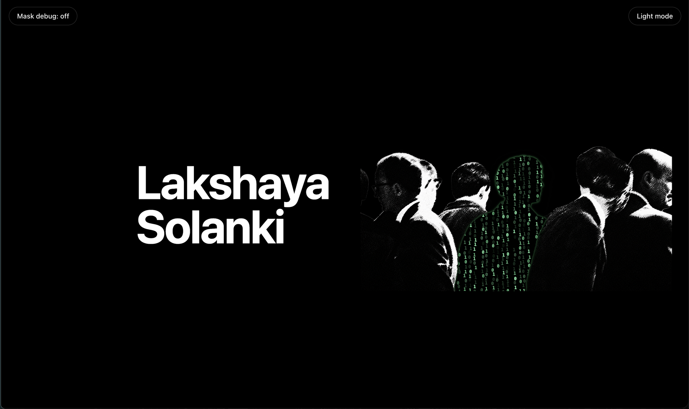
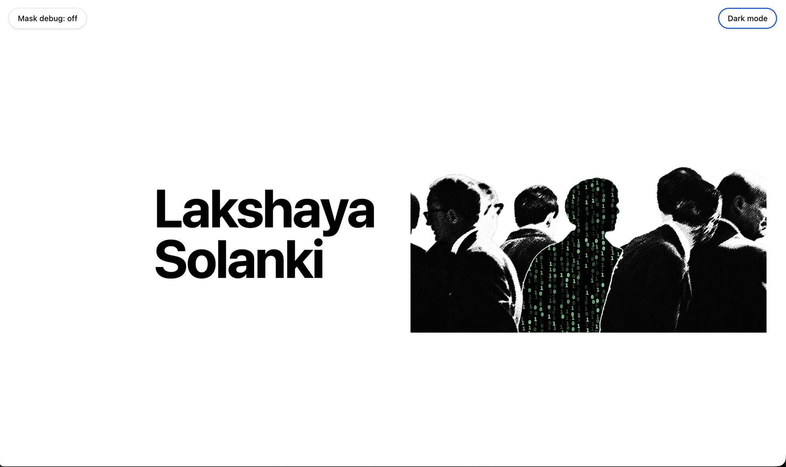

# binary-me

One person in a crowd photo, rendered as a living field of binary digits — clipped pixel-for-pixel to their silhouette, glowing softly against the dark, animating continuously, in both light and dark mode.

<p align="center">
  
  
</p>

<p align="center">
  <video src="doc/media/demo.mov" controls muted playsinline poster="doc/media/screenshot-dark.png" width="100%">
    Your browser can't play the embedded clip — <a href="doc/media/demo.mov">download the recording</a> instead.
  </video>
</p>

<p align="center"><sub>Live walkthrough — theme toggle, the mask debug overlay, and the binary field animating.</sub></p>

## What it is

A static black-and-white crowd photograph sits on the page. One person in it has been cut out by a hand-authored silhouette mask, and in their place a dense, continuously animated field of `0`/`1` glyphs runs — individually varied in brightness, occasionally flickering between `0` and `1`, streaming slowly upward. A thin, soft green rim traces their exact contour — head, face profile, neck, shoulders, the lot — so the edge reads as atmosphere, not a cutout.

Everything is driven by a single `<canvas>` animation loop; nothing here re-renders React.

## Architecture

A crowd photo (`img`) with three stacked `<canvas>` layers on top — a black backing, a soft edge glow, and the animated `0`/`1` field — all clipped to the same `person-mask.png` silhouette. `binaryRenderer.ts` owns the render loop; `BinaryCharacter.tsx` just mounts it and lays it out.

## Project structure

```
src/
  App.tsx                          page layout, theme + debug wiring
  components/
    BinaryCharacter/
      BinaryCharacter.tsx           the four-layer stack + layout/resize wiring
      binaryRenderer.ts             mask compositing, palette, halo, the rAF loop
    ThemeToggle.tsx                 light/dark page toggle
    DebugMaskToggle.tsx             mask debug overlay toggle
  theme/                            React context + provider for the page theme
  assets/binary-character/
    crowd.png                       the source photograph
    person-mask.png                 hand-authored silhouette (geometric source of truth)
doc/
  plan.md                           roadmap
  reference/source.png              original art-direction reference
  media/                            screenshots + demo recording (this README)
```

## Tech stack

- **React 19** + **TypeScript**, built with **Vite**
- **Tailwind CSS v4** for everything except the mask/canvas plumbing (which needs runtime image URLs, so it stays as inline styles)
- **Oxlint** for linting
- No animation, canvas, or masking libraries — the entire effect is hand-rolled Canvas 2D + a bit of CSS

## Getting started

```bash
pnpm install
pnpm dev       # start the dev server
pnpm lint      # oxlint
pnpm build     # tsc -b && vite build
pnpm preview   # preview the production build
```

## Roadmap

- [x] **V1 — shipped.** Static crowd + one silhouette running a dense, animated binary field; light/dark theming; mask-exact compositing; debug overlay.
- [ ] **V2 — planned.** Subtle gaze/life kinetic movement around the *other* people in the crowd — small, ambient motion that makes the whole scene feel alive, not just the highlighted figure.

See [`doc/plan.md`](doc/plan.md) for the source of this roadmap as it evolves.
